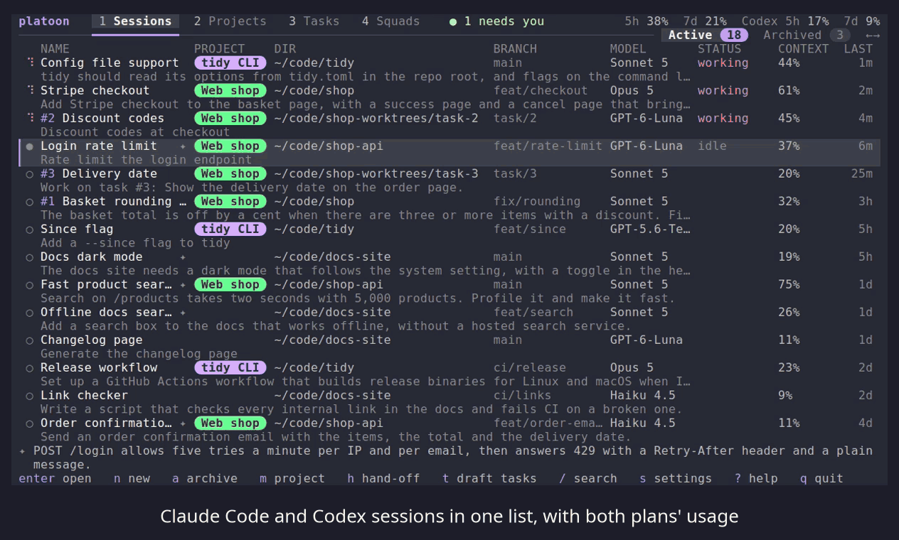

# platoon

Every AI coding session you have, in one terminal app. See them all at a glance, pick up any one where you left it,
group them into projects with shared notes, and start tasks that follow a squad's way of working.



[Full tour (MP4)](demo/platoon-tour.mp4)

platoon works with [Claude Code](https://docs.anthropic.com/en/docs/claude-code) today, on Linux and macOS, and lists and opens your
[Codex](https://github.com/openai/codex) conversations beside it when Codex is installed.

## What it does

- **One list of every conversation**, across every folder: what it's called, whether it's working, waiting for you or
  finished, its model, how full its context is, and your plan usage. Search them, rename them, archive the ones you're
  done with. → [Sessions](guide/sessions.md)
- **Sessions keep running** after you close platoon. Open one again from platoon, or from any terminal with
  `platoon open`, and several windows can share it live. → [Sessions](guide/sessions.md#sessions-started-in-platoon-keep-running)
- **Projects** group conversations from as many folders as you like. A project's notes reach every one of its sessions,
  and can keep themselves up to date as you work. When a conversation gets long, hand the work on to a fresh session
  with one key. → [Projects](guide/projects.md)
- **Tasks and squads**: write down a piece of work as a task (or press `t` on a session and Claude drafts tasks from
  the conversation, each with the squad that suits it), then start it: one Claude Code session in a copy of your folder
  (a git worktree on the branch `task/<N>`), following a squad, a short Markdown file of steps for that kind of work
  (Feature, Bug fix, Incident, Refactor, Explain, Review, Docs, or your own). It can show you its plan first and wait
  for your yes, and it asks you before a push, a pull request or a release. It runs your repo's tests itself, and when
  it stops a fresh Claude checks its work against the task before it is Done. The Tasks tab shows every task across
  your projects and what each one needs from you.
  → [Tasks and squads](guide/tasks-and-squads.md)
- **Your own editor** opens a session's or a task's folders with `v`: VS Code, Zed, JetBrains IDEs, Helix, Neovim
  and others. → [Sessions](guide/sessions.md#opening-the-editor-v)
- **52 themes**, dark and light, or your own. → [Themes](guide/themes.md)

## Install

You need Linux or macOS, Claude Code (`claude`) or Codex (`codex`) installed and signed in (tasks need Claude Code for
now), and a terminal of at least 60 by 14. Any one of these:

```
brew install ctrader2/tap/platoon                    # Homebrew (macOS, Linux)
curl -LsSf https://github.com/ctrader2/platoon/releases/latest/download/platoon-tui-installer.sh | sh
cargo install platoon-tui                            # Rust 1.88 or newer
nix run github:ctrader2/platoon                      # Nix
```

Then, once:

```
platoon setup
platoon
```

`platoon setup` shows what it will add to Claude Code's settings, backs the file up first, and is safe to run again.
→ [Install and set up](guide/install-and-setup.md)

Press `?` anywhere in platoon to see every key. `ctrl+space` goes back; `q` quits from the main lists.

## What platoon changes on your computer

- **Claude Code's `settings.json`**: a status line and three hooks (a guard against two copies of one conversation,
  and two that carry a project's notes to its sessions). Nothing else in the file is touched, and a status line of your
  own is left alone.
- **Codex's `hooks.json`**, only when Codex is installed: three hooks that carry a project's notes to its Codex sessions.
  Setup has Codex mark them trusted, so Codex doesn't ask (Codex writes that record in its own `config.toml`).
- **Its own folders**: `~/.config/platoon` and `~/.cache/platoon`, and a `<repo>-worktrees` folder beside a repository
  when a task works on it.
- **Your plan's tokens: nothing until you say yes.** Smart names, search by description and notes that update
  themselves use your Claude plan (or your ChatGPT plan through Codex, for an OpenAI model), so they are off until you
  turn them on, with a daily limit.
- **A task's session edits files without asking** (Claude Code's "accept edits" mode, after plan mode for a squad that
  plans first), inside the task's copy of the folder. It still asks before a push, a pull request or a release. When
  the session stops, a fresh Claude that can only read checks the work against the task before it is Done (it uses
  your plan, whatever the switches say).
- **No telemetry, and one network request**: once a day at most, platoon asks GitHub whether a newer platoon is out
  (it sends only platoon's version number; a setting turns it off). Claude Code does its own talking to Anthropic.

platoon reads Claude Code's own files, which aren't a documented format, so a Claude Code update can break something.
It was last checked with Claude Code 2.1.288. → [What platoon changes](guide/what-platoon-changes.md)

## Uninstall

```
curl -LsSf https://raw.githubusercontent.com/ctrader2/platoon/main/scripts/uninstall.sh | sh
```

It takes platoon's status line and hooks out of Claude Code (backing `settings.json` up first), deletes platoon's cache, asks before deleting your projects, notes, tasks and
settings (`| sh -s -- --all` deletes them without asking) and before stopping any session platoon is running, then
removes the program however you installed it. Your conversations are Claude Code's and are never touched; task
worktrees are listed, not deleted.
→ [Uninstall](guide/install-and-setup.md#uninstall)

## Learn more

The [guide](guide/README.md) covers everything:
[install and setup](guide/install-and-setup.md),
[sessions](guide/sessions.md),
[projects](guide/projects.md),
[tasks and squads](guide/tasks-and-squads.md),
[themes](guide/themes.md),
[settings and keys](guide/settings-and-keys.md),
[features that use tokens](guide/tokens.md),
[what platoon changes](guide/what-platoon-changes.md) and
[troubleshooting](guide/troubleshooting.md).

## License

MIT: see [LICENSE](LICENSE). The color themes belong to their authors and are credited in
[THIRD_PARTY_NOTICES.md](THIRD_PARTY_NOTICES.md).

platoon is an independent project. It is not affiliated with or endorsed by Anthropic, OpenAI or Google. Claude and
Claude Code are trademarks of Anthropic.

## Contributing

Bug reports, ideas and pull requests are welcome: [CONTRIBUTING.md](CONTRIBUTING.md) says how. Found a security problem?
Please report it privately, as [SECURITY.md](SECURITY.md) describes.
